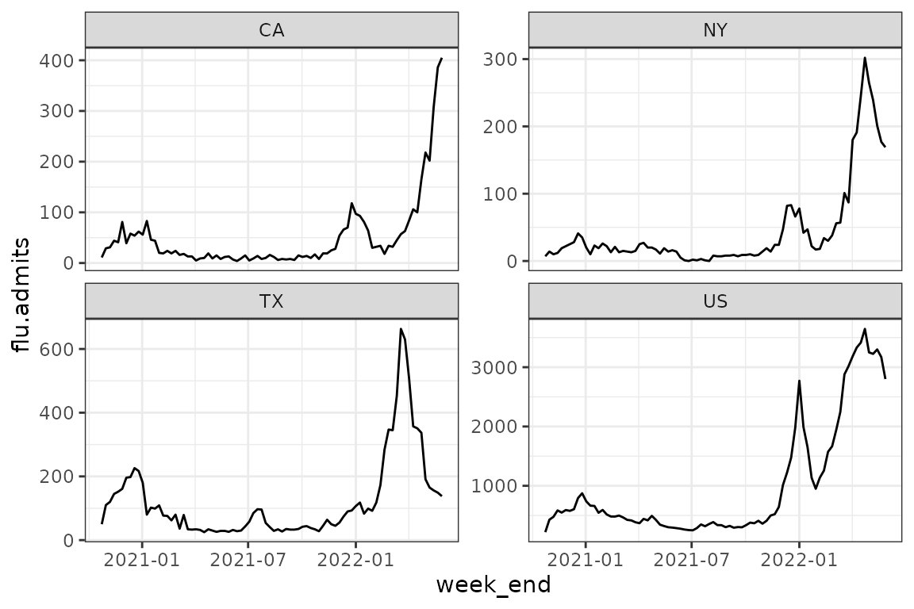
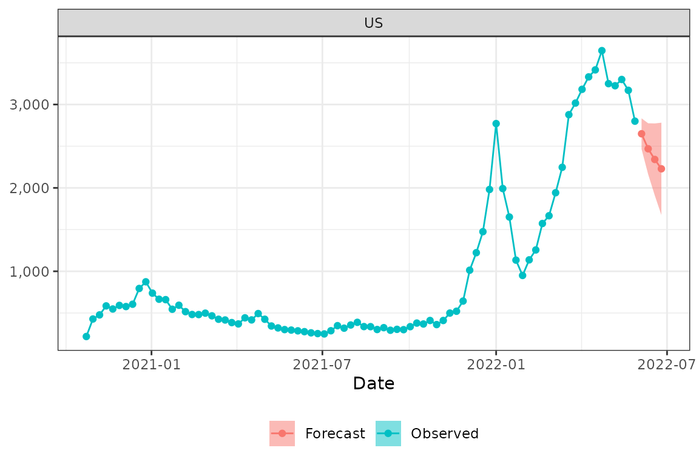
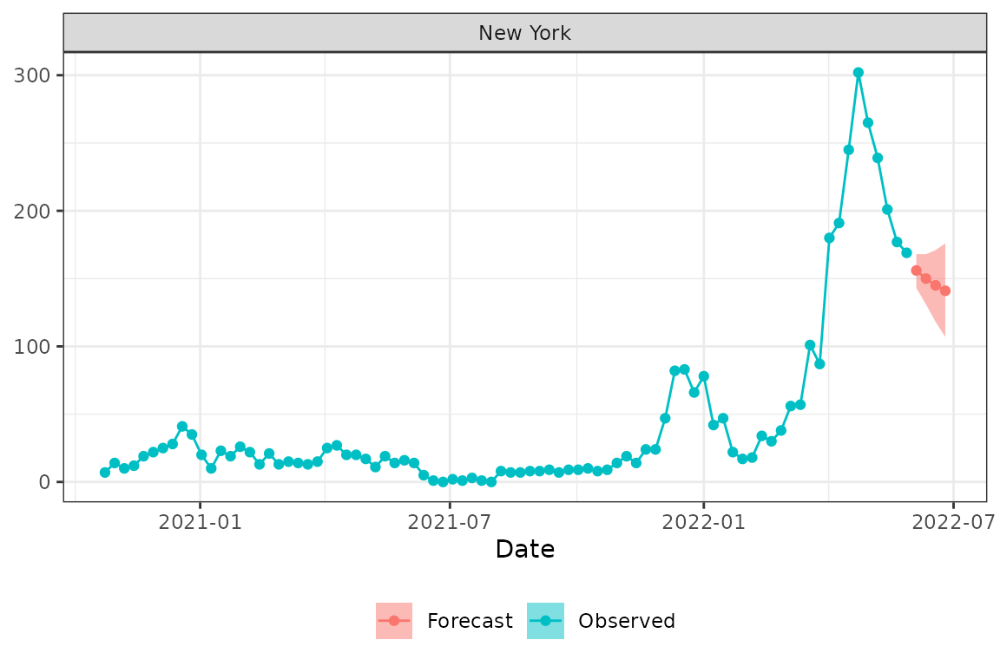
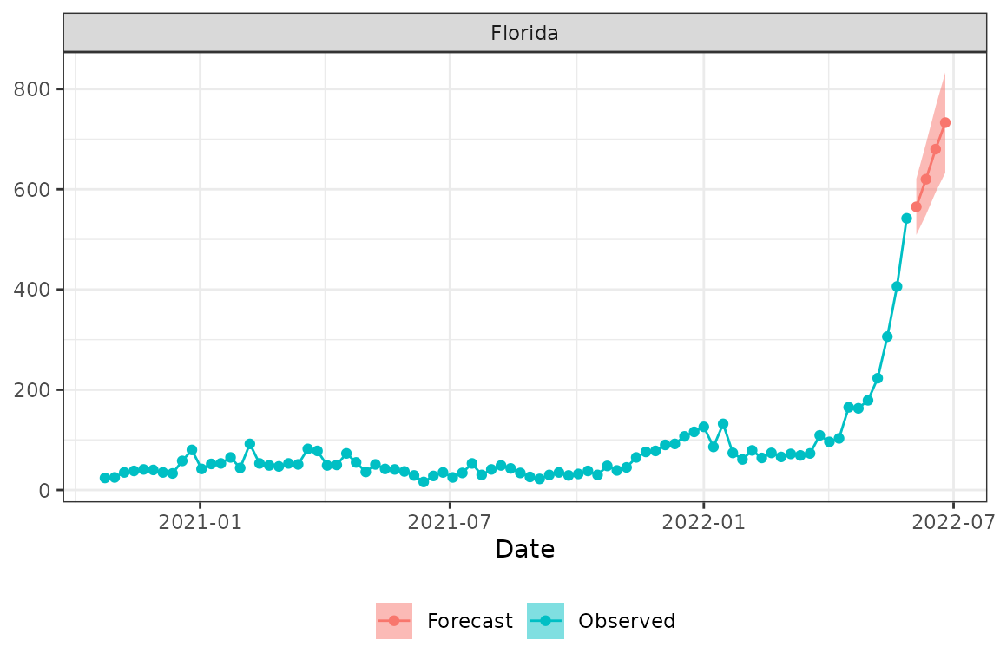
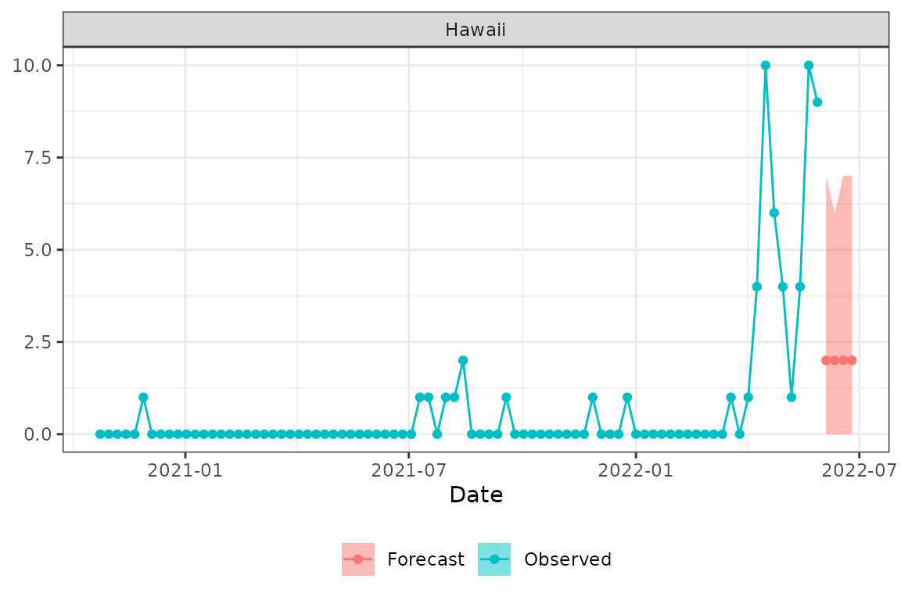

# Basic Usage

## Overview

The fiphde (**f**orecasting **i**nfluenza in support of **p**ublic
**h**ealth **de**cision making) package provides utilities for
forecasting influenza hospitalizations in the United States. fiphde
includes functions for retrieving hospitalization time series data from
the HHS Protect system at
[HealthData.gov](https://healthdata.gov/Hospital/COVID-19-Reported-Patient-Impact-and-Hospital-Capa/g62h-syeh),
preparing raw data for forecasting, fitting time series and count
regression models to create probabilistic forecasts for influenza
hospitalizations at state and national levels, visualizing and
evaluating forecasts, and formatting forecasts for submission to
[FluSight](https://www.cdc.gov/flu/weekly/flusight/index.html).

fiphde rhymes with “fifty,” as in the 50 states in the US.

## Usage

The fiphde package retrieves current data from HHS and CDC APIs and fits
models and forecasts using this data. This vignette uses data current to
May 28, 2022 (MMWR epidemiological week 21 of 2022). Running the code
here as written will produce different results depending on *when* you
run the code, as new data is constantly being added and historical data
is constantly being revised.

To get started, load the packages that are used in this vignette.

``` r

library(fiphde)
library(dplyr)
library(purrr)
library(readr)
library(ggplot2)
theme_set(theme_bw())
```

### Data retrieval

Prior to fitting any forecasts we need to first retrieve data from the
[HealthData.gov COVID-19 Reported Patient Impact and Hospital Capacity
by State Timeseries
API](https://healthdata.gov/Hospital/COVID-19-Reported-Patient-Impact-and-Hospital-Capa/g62h-syeh).
Running `get_hdgov_hosp(limitcols=TRUE)` will initiate an API call with
an argument to return only a selection of fields relevant to flu
hospitalization reporting.

``` r

hosp <- get_hdgov_hosp(limitcols = TRUE)
```

``` r

hosp
#> # A tibble: 43,967 × 14
#>    state date       flu.admits flu.admits.cov flu.deaths flu.deaths.cov flu.icu
#>    <chr> <date>          <dbl>          <dbl>      <dbl>          <dbl>   <dbl>
#>  1 AL    2019-12-31         NA              0         NA              0      NA
#>  2 HI    2019-12-31         NA              0         NA              0      NA
#>  3 IN    2019-12-31         NA              0         NA              0      NA
#>  4 LA    2019-12-31         NA              0         NA              0      NA
#>  5 MN    2019-12-31         NA              0         NA              0      NA
#>  6 MT    2019-12-31         NA              0         NA              0      NA
#>  7 NC    2019-12-31         NA              0         NA              0      NA
#>  8 PR    2019-12-31         NA              0         NA              0      NA
#>  9 TX    2019-12-31         NA              0         NA              0      NA
#> 10 AL    2020-01-01         NA              0         NA              0      NA
#> # ℹ 43,957 more rows
#> # ℹ 7 more variables: flu.icu.cov <dbl>, flu.tot <dbl>, flu.tot.cov <dbl>,
#> #   cov.admits <dbl>, cov.admits.cov <dbl>, cov.deaths <dbl>,
#> #   cov.deaths.cov <dbl>
```

### Time series forecasting

We will first fit a time series model, creating an ensemble model from
ARIMA and exponential smoothing models. Time series modeling is based on
the tidyverts (<https://tidyverts.org/>) collection of packages for tidy
time series forecasting in R.

#### Data preparation

We need to initially prepare the data for a time series forecast. The
`prep_hdgov_hosp` function call below will limit to states only (no
territories), remove any data from an incomplete epidemiological week
(Sunday-Saturday), remove locations with little to no reported
hospitalizations over the last month, and further exclude Washington DC
from downstream analysis. The function aggregates total number of cases
at each epidemiological week at each location. This function also adds
in location FIPS codes, and joins in historical influenza-like illness
(ILI) and hospitalization mean values and ranks by week. Historical
indicators for ILI and hospitalizations are summarized from [CDC
ILINet](https://gis.cdc.gov/grasp/fluview/fluportaldashboard.html) and
[CDC
FluSurv-Net](https://www.cdc.gov/flu/weekly/influenza-hospitalization-surveillance.htm)
respectively.

``` r

# Prep data
prepped_hosp <-
  hosp %>%
  prep_hdgov_hosp(statesonly=TRUE, min_per_week = 0, remove_incomplete = TRUE) %>%
  dplyr::filter(abbreviation != "DC")
```

``` r

prepped_hosp
#> # A tibble: 4,284 × 13
#>    abbreviation location week_start monday     week_end   epiyear epiweek
#>    <chr>        <chr>    <date>     <date>     <date>       <dbl>   <dbl>
#>  1 US           US       2020-10-18 2020-10-19 2020-10-24    2020      43
#>  2 US           US       2020-10-25 2020-10-26 2020-10-31    2020      44
#>  3 US           US       2020-11-01 2020-11-02 2020-11-07    2020      45
#>  4 US           US       2020-11-08 2020-11-09 2020-11-14    2020      46
#>  5 US           US       2020-11-15 2020-11-16 2020-11-21    2020      47
#>  6 US           US       2020-11-22 2020-11-23 2020-11-28    2020      48
#>  7 US           US       2020-11-29 2020-11-30 2020-12-05    2020      49
#>  8 US           US       2020-12-06 2020-12-07 2020-12-12    2020      50
#>  9 US           US       2020-12-13 2020-12-14 2020-12-19    2020      51
#> 10 US           US       2020-12-20 2020-12-21 2020-12-26    2020      52
#> # ℹ 4,274 more rows
#> # ℹ 6 more variables: flu.admits <dbl>, flu.admits.cov <dbl>, ili_mean <dbl>,
#> #   ili_rank <int>, hosp_mean <dbl>, hosp_rank <int>
```

Now let’s explore the data.

``` r

prepped_hosp %>% 
  filter(abbreviation %in% c("US", "CA", "TX", "NY")) %>% 
  ggplot(aes(week_end, flu.admits)) + geom_line() + 
  facet_wrap(~abbreviation, scale="free_y")
```



What states had the highest admissions over the 2021-2022 flu season?

``` r

prepped_hosp %>% 
  filter(abbreviation!="US") %>% 
  filter(week_start>="2021-07-01" & week_end<"2022-06-30") %>% 
  group_by(abbreviation) %>% 
  summarize(total.flu.admits=sum(flu.admits)) %>% 
  arrange(desc(total.flu.admits)) %>% 
  head(10) %>% 
  knitr::kable(caption="Top 10 states with highest flu hospitalizations in 2021-2022.")
```

| abbreviation | total.flu.admits |
|:-------------|-----------------:|
| TX           |             7164 |
| FL           |             4550 |
| PA           |             3286 |
| CA           |             3233 |
| NY           |             3073 |
| AZ           |             2819 |
| MI           |             2511 |
| OK           |             2358 |
| OH           |             2169 |
| MA           |             2141 |

Top 10 states with highest flu hospitalizations in 2021-2022. {.table}

Next let’s turn this into a [tsibble](https://tsibble.tidyverts.org/).
tsibble objects are tibbles with an *index* variable describing the
inherent ordering from past to present, and a *key* that defines
observational units over time. The `make_tsibble` function provides a
convenience wrapper around
[`tsibble::as_tsibble`](https://tsibble.tidyverts.org/reference/as-tsibble.html)
using the epidemiological week’s Monday as the weekly index and the
location as the key. Note that the specification of arguments for
epidemiological week / year and location key are passed as “bare”
(unquoted) names of columns storing this information in the original
tibble.

``` r

prepped_hosp_tsibble <- make_tsibble(prepped_hosp,
                                     epiyear=epiyear,
                                     epiweek=epiweek,
                                     key=location)
```

``` r

prepped_hosp_tsibble
#> # A tsibble: 4,284 x 14 [1W]
#> # Key:       location [51]
#>    abbreviation location week_start monday        yweek week_end   epiyear
#>    <chr>        <chr>    <date>     <date>       <week> <date>       <dbl>
#>  1 AL           01       2020-10-18 2020-10-19 2020 W43 2020-10-24    2020
#>  2 AL           01       2020-10-25 2020-10-26 2020 W44 2020-10-31    2020
#>  3 AL           01       2020-11-01 2020-11-02 2020 W45 2020-11-07    2020
#>  4 AL           01       2020-11-08 2020-11-09 2020 W46 2020-11-14    2020
#>  5 AL           01       2020-11-15 2020-11-16 2020 W47 2020-11-21    2020
#>  6 AL           01       2020-11-22 2020-11-23 2020 W48 2020-11-28    2020
#>  7 AL           01       2020-11-29 2020-11-30 2020 W49 2020-12-05    2020
#>  8 AL           01       2020-12-06 2020-12-07 2020 W50 2020-12-12    2020
#>  9 AL           01       2020-12-13 2020-12-14 2020 W51 2020-12-19    2020
#> 10 AL           01       2020-12-20 2020-12-21 2020 W52 2020-12-26    2020
#> # ℹ 4,274 more rows
#> # ℹ 7 more variables: epiweek <dbl>, flu.admits <dbl>, flu.admits.cov <dbl>,
#> #   ili_mean <dbl>, ili_rank <int>, hosp_mean <dbl>, hosp_rank <int>
```

#### Fit a model and forecast

Next, let’s fit a time series model and create forecasts using the
`ts_fit_forecast` function. This function takes a tsibble created as
above, a forecast horizon in weeks, the name of the outcome variable to
forecast, and optional covariates to use in the ARIMA model.

Here we fit a non-seasonal ARIMA model with the autoregressive term (p)
restricted to 1:2, order of integration for differencing (d) restricted
to 0:2, and the moving average (q) restricted to 0 (see
[`?fable::ARIMA`](https://fable.tidyverts.org/reference/ARIMA.html) for
more information). The model also fits a non-seasonal exponential
smoothing model (see
[`?fable::ETS`](https://fable.tidyverts.org/reference/ETS.html) for
details). In this example we do not fit an autoregressive neural network
model, but we could change `nnetar=NULL` to `nnetar="AR(P=1)"` to do so
(see `?fable::nnetar` for details). We can also trim the data used in
modeling, and here we restrict to only include hospitalization data
reported after January 1, 2021. By setting `ensemble=TRUE` we create an
ensemble model that averages the ARIMA and exponential smoothing models.

``` r

hosp_fitfor <- ts_fit_forecast(prepped_hosp_tsibble,
                               horizon=4L,
                               outcome="flu.admits",
                               trim_date = "2021-01-01",
                               covariates=TRUE, 
                               models=list(arima='PDQ(0, 0, 0) + pdq(1:2, 0:2, 0)',
                                           ets='season(method="N")',
                                           nnetar=NULL), 
                               ensemble=TRUE)
```

The function will output messages describing the ARIMA and ETS model
formulas passed to
[`fable::ARIMA`](https://fable.tidyverts.org/reference/ARIMA.html) and
[`fable::ETS`](https://fable.tidyverts.org/reference/ETS.html).

    Trimming to 2021-01-01
    ARIMA  formula: flu.admits ~ PDQ(0, 0, 0) + pdq(1:2, 0:2, 0) + hosp_rank + ili_rank
    ETS    formula: flu.admits ~ season(method = "N")

After fitting the models, the function then forecasts the outcome to the
specified number of weeks. Let’s take a look at the object returned from
this model fit + forecast. We see `$tsfit`, which gives us the ARIMA,
ETS, and ensemble model fits as list columns, one row per location;
`$tsfor` gives us the forecast for the next four weeks, one row per
model per location (key in the tsibble); `$formulas` gives us the model
formulas passed to fable modeling functions; and if any models failed to
converge we would see those locations in `$nullmodels`.

``` r

hosp_fitfor
#> $tsfit
#> # A mable: 51 x 4
#> # Key:     location [51]
#>    location                       arima          ets      ensemble
#>    <chr>                      <lst_mdl>    <lst_mdl>     <lst_mdl>
#>  1 01       <LM w/ ARIMA(2,0,0) errors> <ETS(A,N,N)> <COMBINATION>
#>  2 02       <LM w/ ARIMA(1,0,0) errors> <ETS(A,N,N)> <COMBINATION>
#>  3 04       <LM w/ ARIMA(2,1,0) errors> <ETS(M,N,N)> <COMBINATION>
#>  4 05       <LM w/ ARIMA(2,1,0) errors> <ETS(A,N,N)> <COMBINATION>
#>  5 06       <LM w/ ARIMA(2,2,0) errors> <ETS(M,A,N)> <COMBINATION>
#>  6 08       <LM w/ ARIMA(1,1,0) errors> <ETS(A,N,N)> <COMBINATION>
#>  7 09       <LM w/ ARIMA(1,1,0) errors> <ETS(A,N,N)> <COMBINATION>
#>  8 10       <LM w/ ARIMA(2,1,0) errors> <ETS(A,N,N)> <COMBINATION>
#>  9 12       <LM w/ ARIMA(2,2,0) errors> <ETS(M,N,N)> <COMBINATION>
#> 10 13       <LM w/ ARIMA(2,1,0) errors> <ETS(A,N,N)> <COMBINATION>
#> # ℹ 41 more rows
#> 
#> $tsfor
#> # A fable: 612 x 10 [1W]
#> # Key:     location, .model [153]
#>    location .model      yweek
#>    <chr>    <chr>      <week>
#>  1 01       arima    2022 W22
#>  2 01       arima    2022 W23
#>  3 01       arima    2022 W24
#>  4 01       arima    2022 W25
#>  5 01       ets      2022 W22
#>  6 01       ets      2022 W23
#>  7 01       ets      2022 W24
#>  8 01       ets      2022 W25
#>  9 01       ensemble 2022 W22
#> 10 01       ensemble 2022 W23
#> # ℹ 602 more rows
#> # ℹ 7 more variables: flu.admits <dist>, .mean <dbl>, epiweek <dbl>,
#> #   ili_mean <dbl>, ili_rank <int>, hosp_mean <dbl>, hosp_rank <int>
#> 
#> $formulas
#> $formulas$arima
#> flu.admits ~ PDQ(0, 0, 0) + pdq(1:2, 0:2, 0) + hosp_rank + ili_rank
#> <environment: 0x557cc8f190e0>
#> 
#> $formulas$ets
#> flu.admits ~ season(method = "N")
#> <environment: 0x557cc8f190e0>
#> 
#> 
#> $nullmodels
#> # A tibble: 0 × 2
#> # ℹ 2 variables: location <chr>, model <chr>
```

Next, we can format the forecasts for [submission to
FluSight](https://github.com/cdcepi/Flusight-forecast-data/blob/master/data-forecasts/README.md)
using the `format_for_submission` function.

``` r

formatted_list <- format_for_submission(hosp_fitfor$tsfor, method = "ts", format = "legacy")
```

The list contains separate submission-ready tibbles, one element for
each type of model fitted.

``` r

formatted_list
#> $arima
#> # A tibble: 4,896 × 7
#>    forecast_date target            target_end_date location type  quantile value
#>    <date>        <chr>             <date>          <chr>    <chr> <chr>    <chr>
#>  1 2024-12-10    1 wk ahead inc f… 2022-06-04      01       point NA       17   
#>  2 2024-12-10    2 wk ahead inc f… 2022-06-11      01       point NA       21   
#>  3 2024-12-10    3 wk ahead inc f… 2022-06-18      01       point NA       20   
#>  4 2024-12-10    4 wk ahead inc f… 2022-06-25      01       point NA       22   
#>  5 2024-12-10    1 wk ahead inc f… 2022-06-04      01       quan… 0.010    0    
#>  6 2024-12-10    2 wk ahead inc f… 2022-06-11      01       quan… 0.010    4    
#>  7 2024-12-10    3 wk ahead inc f… 2022-06-18      01       quan… 0.010    1    
#>  8 2024-12-10    4 wk ahead inc f… 2022-06-25      01       quan… 0.010    3    
#>  9 2024-12-10    1 wk ahead inc f… 2022-06-04      01       quan… 0.025    2    
#> 10 2024-12-10    2 wk ahead inc f… 2022-06-11      01       quan… 0.025    6    
#> # ℹ 4,886 more rows
#> 
#> $ensemble
#> # A tibble: 4,896 × 7
#>    forecast_date target            target_end_date location type  quantile value
#>    <date>        <chr>             <date>          <chr>    <chr> <chr>    <chr>
#>  1 2024-12-10    1 wk ahead inc f… 2022-06-04      01       point NA       18   
#>  2 2024-12-10    2 wk ahead inc f… 2022-06-11      01       point NA       20   
#>  3 2024-12-10    3 wk ahead inc f… 2022-06-18      01       point NA       19   
#>  4 2024-12-10    4 wk ahead inc f… 2022-06-25      01       point NA       20   
#>  5 2024-12-10    1 wk ahead inc f… 2022-06-04      01       quan… 0.010    0    
#>  6 2024-12-10    2 wk ahead inc f… 2022-06-11      01       quan… 0.010    1    
#>  7 2024-12-10    3 wk ahead inc f… 2022-06-18      01       quan… 0.010    0    
#>  8 2024-12-10    4 wk ahead inc f… 2022-06-25      01       quan… 0.010    0    
#>  9 2024-12-10    1 wk ahead inc f… 2022-06-04      01       quan… 0.025    3    
#> 10 2024-12-10    2 wk ahead inc f… 2022-06-11      01       quan… 0.025    4    
#> # ℹ 4,886 more rows
#> 
#> $ets
#> # A tibble: 4,896 × 7
#>    forecast_date target            target_end_date location type  quantile value
#>    <date>        <chr>             <date>          <chr>    <chr> <chr>    <chr>
#>  1 2024-12-10    1 wk ahead inc f… 2022-06-04      01       point NA       19   
#>  2 2024-12-10    2 wk ahead inc f… 2022-06-11      01       point NA       19   
#>  3 2024-12-10    3 wk ahead inc f… 2022-06-18      01       point NA       19   
#>  4 2024-12-10    4 wk ahead inc f… 2022-06-25      01       point NA       19   
#>  5 2024-12-10    1 wk ahead inc f… 2022-06-04      01       quan… 0.010    0    
#>  6 2024-12-10    2 wk ahead inc f… 2022-06-11      01       quan… 0.010    0    
#>  7 2024-12-10    3 wk ahead inc f… 2022-06-18      01       quan… 0.010    0    
#>  8 2024-12-10    4 wk ahead inc f… 2022-06-25      01       quan… 0.010    0    
#>  9 2024-12-10    1 wk ahead inc f… 2022-06-04      01       quan… 0.025    2    
#> 10 2024-12-10    2 wk ahead inc f… 2022-06-11      01       quan… 0.025    1    
#> # ℹ 4,886 more rows
```

We can check to see if the submission is
[valid](https://github.com/cdcepi/Flusight-forecast-data/blob/e1a2a05fa2bb065dfa80a7067c444394edde05e2/data-forecasts/README.md#Forecast-validation).
Note that this will fail if the expected date of the target dates and
current dates don’t line up. You’ll see a message noting *“The
submission target end dates do not line up with expected Saturdays by
horizon. Note if submission forecast date is not Sunday or Monday, then
forecasts are assumed to to start the following week.”* If validation
succeeds, the `$valid` element of the returned list will be `TRUE`, and
`FALSE` if any validation checks fail.

``` r

validate_forecast(formatted_list$ensemble)
```

Let’s plot the forecast with the observed data using the `plot_forecast`
function. Here we plot forecasts with the 50% prediction interval for
US, New York (FIPS 36) and Florida (FIPS 12).

``` r

plot_forecast(prepped_hosp, formatted_list$ensemble, loc="US", pi = .5)
```



``` r

plot_forecast(prepped_hosp, formatted_list$ensemble, loc="36", pi = .5)
```



``` r

plot_forecast(prepped_hosp, formatted_list$ensemble, loc="12", pi = .5)
```



Finally, we can pull out the ARIMA model parameters used for each
location to save for posterity or retrospective analysis.

``` r

hosp_fitfor$tsfit$arima %>% 
  map("fit") %>% 
  map_df("spec") %>% 
  mutate(location = hosp_fitfor$tsfit$location, .before = "p")
#>    location p d q P D Q constant period
#> 1        01 2 0 0 0 0 0     TRUE     52
#> 2        02 1 0 0 0 0 0     TRUE     52
#> 3        04 2 1 0 0 0 0    FALSE     52
#> 4        05 2 1 0 0 0 0    FALSE     52
#> 5        06 2 2 0 0 0 0    FALSE     52
#> 6        08 1 1 0 0 0 0    FALSE     52
#> 7        09 1 1 0 0 0 0    FALSE     52
#> 8        10 2 1 0 0 0 0    FALSE     52
#> 9        12 2 2 0 0 0 0    FALSE     52
#> 10       13 2 1 0 0 0 0    FALSE     52
#> 11       15 2 1 0 0 0 0    FALSE     52
#> 12       16 1 1 0 0 0 0    FALSE     52
#> 13       17 1 1 0 0 0 0    FALSE     52
#> 14       18 1 1 0 0 0 0    FALSE     52
#> 15       19 2 1 0 0 0 0    FALSE     52
#> 16       20 1 1 0 0 0 0    FALSE     52
#> 17       21 1 1 0 0 0 0    FALSE     52
#> 18       22 1 1 0 0 0 0    FALSE     52
#> 19       23 2 1 0 0 0 0     TRUE     52
#> 20       24 2 1 0 0 0 0    FALSE     52
#> 21       25 1 1 0 0 0 0    FALSE     52
#> 22       26 1 1 0 0 0 0    FALSE     52
#> 23       27 1 1 0 0 0 0    FALSE     52
#> 24       28 2 1 0 0 0 0    FALSE     52
#> 25       29 2 1 0 0 0 0    FALSE     52
#> 26       30 2 1 0 0 0 0    FALSE     52
#> 27       31 1 1 0 0 0 0    FALSE     52
#> 28       32 1 1 0 0 0 0    FALSE     52
#> 29       33 1 1 0 0 0 0    FALSE     52
#> 30       34 1 1 0 0 0 0    FALSE     52
#> 31       35 1 1 0 0 0 0    FALSE     52
#> 32       36 2 1 0 0 0 0    FALSE     52
#> 33       37 2 1 0 0 0 0    FALSE     52
#> 34       38 1 1 0 0 0 0    FALSE     52
#> 35       39 2 1 0 0 0 0    FALSE     52
#> 36       40 1 1 0 0 0 0    FALSE     52
#> 37       41 1 1 0 0 0 0    FALSE     52
#> 38       42 1 1 0 0 0 0    FALSE     52
#> 39       44 2 1 0 0 0 0    FALSE     52
#> 40       45 2 1 0 0 0 0    FALSE     52
#> 41       46 2 1 0 0 0 0    FALSE     52
#> 42       47 2 1 0 0 0 0    FALSE     52
#> 43       48 1 1 0 0 0 0    FALSE     52
#> 44       49 1 1 0 0 0 0    FALSE     52
#> 45       50 2 1 0 0 0 0    FALSE     52
#> 46       51 1 1 0 0 0 0    FALSE     52
#> 47       53 2 2 0 0 0 0    FALSE     52
#> 48       54 1 1 0 0 0 0    FALSE     52
#> 49       55 1 1 0 0 0 0    FALSE     52
#> 50       56 2 1 0 0 0 0    FALSE     52
#> 51       US 2 1 0 0 0 0    FALSE     52
```

### Count regression forecasting

The time series methods above assume that the outcome has a continuous
distribution. When forecasting *counts* and especially *small counts*
(e.g., “how many influenza hospitalizations will occur next week in
Hawaii?”) alternative methods may have more desirable properties. fiphde
provides functionality to leverage count regression models for
forecasting influenza hospitalizations. Here we will demonstrate how to
implement a count regression modeling approach. The example will step
through the process of forecasting hospitalizations in Hawaii by using
influenza-like illness (ILI) and indicators of historical
hospitalization and ILI severity for the given epidemiological weeks.
The usage illustrates an automated tuning procedure that finds the
“best” models from possible covariates and model families (e.g.,
Poisson, Quasipoisson, Negative binomial, etc.).

#### ILI retrieval and prep

Given that ILI will be a covariate in the count regression model, we
must first retrieve ILI data using the
[`get_cdc_ili()`](https://signaturescience.github.io/fiphde/reference/get_cdc_ili.md)
function, which is a wrapper around
[`ilinet()`](https://signaturescience.github.io/fiphde/reference/ilinet.md).
Here, we’re only using recent ILI data (i.e., since 2019) and we further
filter the signal to only include Hawaii. ILI is subject to revision and
may be less reliable when initially reported, so we replace the current
week and one week previous with [Nowcast
data](https://delphi.cmu.edu/nowcast/). Finally, we fit a time series
model to forecast ILI for the next four weeks.

``` r

ilidat <- 
  get_cdc_ili(region=c("state"), years=2019:2022) %>%
  filter(region == "Hawaii") %>%
  replace_ili_nowcast(., weeks_to_replace=1)

ilifor <- forecast_ili(ilidat, horizon=4L, trim_date="2020-03-01")
```

In the next step we are going to log transform weighted ILI and flu
admissions, so in this step we need to remove all the zeros. The fiphde
package provides the `mnz_replace` function which replaces zeros in a
variable with the smallest non-zero value of that variable.

``` r

ilidat <- ilidat %>% mutate(weighted_ili=mnz_replace(weighted_ili))

ilifor$ilidat <- ilifor$ilidat %>% mutate(ili=mnz_replace(ili))
ilifor$ili_future <- ilifor$ili_future %>% mutate(ili=mnz_replace(ili))
ilifor$ili_bound <- ilifor$ili_bound  %>% mutate(ili=mnz_replace(ili))
```

Finally, we create our modeling dataset by combining the flu admission
data prepared above with the forecasted ILI data in future weeks
together with the historical severity data by epidemiological week.

``` r

dat_hi <-
  prepped_hosp %>%
  filter(abbreviation=="HI") %>%
  dplyr::mutate(date = MMWRweek::MMWRweek2Date(epiyear, epiweek)) %>%
  left_join(ilifor$ilidat, by = c("epiyear", "location", "epiweek")) %>%
  mutate(ili = log(ili))
dat_hi
#> # A tibble: 84 × 15
#>    abbreviation location week_start monday     week_end   epiyear epiweek
#>    <chr>        <chr>    <date>     <date>     <date>       <dbl>   <dbl>
#>  1 HI           15       2020-10-18 2020-10-19 2020-10-24    2020      43
#>  2 HI           15       2020-10-25 2020-10-26 2020-10-31    2020      44
#>  3 HI           15       2020-11-01 2020-11-02 2020-11-07    2020      45
#>  4 HI           15       2020-11-08 2020-11-09 2020-11-14    2020      46
#>  5 HI           15       2020-11-15 2020-11-16 2020-11-21    2020      47
#>  6 HI           15       2020-11-22 2020-11-23 2020-11-28    2020      48
#>  7 HI           15       2020-11-29 2020-11-30 2020-12-05    2020      49
#>  8 HI           15       2020-12-06 2020-12-07 2020-12-12    2020      50
#>  9 HI           15       2020-12-13 2020-12-14 2020-12-19    2020      51
#> 10 HI           15       2020-12-20 2020-12-21 2020-12-26    2020      52
#> # ℹ 74 more rows
#> # ℹ 8 more variables: flu.admits <dbl>, flu.admits.cov <dbl>, ili_mean <dbl>,
#> #   ili_rank <int>, hosp_mean <dbl>, hosp_rank <int>, date <date>, ili <dbl>
```

#### Fit a model and forecast

First we create a list of different count regression models to fit. We
can inspect the formulations of each model. Note that these models are
specified using the [trending
package](https://github.com/reconverse/trending) and internally the
[trendeval package](https://github.com/reconverse/trendeval) is used to
determine the best fitting approach.

``` r

models <-
  list(
    poisson = trending::glm_model(flu.admits ~ ili + hosp_rank + ili_rank, family = "poisson"),
    quasipoisson = trending::glm_model(flu.admits ~ ili + hosp_rank + ili_rank, family = "quasipoisson"),
    negbin = trending::glm_nb_model(flu.admits ~ ili + hosp_rank + ili_rank)
  )
models$poisson
#> Untrained trending model:
#>     glm(formula = flu.admits ~ ili + hosp_rank + ili_rank, family = "poisson")
models$quasipoisson
#> Untrained trending model:
#>     glm(formula = flu.admits ~ ili + hosp_rank + ili_rank, family = "quasipoisson")
models$negbin
#> Untrained trending model:
#>     glm.nb(formula = flu.admits ~ ili + hosp_rank + ili_rank)
```

We must next project covariates four weeks into the future, which we can
accomplish by pulling from the forecasted ILI and historical severity
data.

``` r

new_cov <-
  ilifor$ili_future %>%
  left_join(fiphde:::historical_severity, by="epiweek") %>%
  select(-epiweek,-epiyear) %>%
  mutate(ili = log(ili))
new_cov
#> # A tibble: 4 × 6
#>   location   ili ili_mean ili_rank hosp_mean hosp_rank
#>   <chr>    <dbl>    <dbl>    <int>     <dbl>     <int>
#> 1 15       0.655    1.02        12         0         0
#> 2 15       0.634    0.985       10         0         0
#> 3 15       0.642    0.946        9         0         0
#> 4 15       0.644    0.920        8         0         0
```

Next we use fiphde’s `glm_wrap` function which attempts to find the
best-fitting model out of all the models supplied, and specifies the
prediction interval quantiles used in FluSight.

``` r

res <- glm_wrap(dat_hi,
                new_covariates = new_cov,
                .models = models,
                alpha = c(0.01, 0.025, seq(0.05, 0.5, by = 0.05)) * 2)
res$forecasts$location <- "15"
```

We can take a quick look at the forecast output as well as different
aspects of the final fitted model.

``` r

head(res$forecasts)
#> # A tibble: 6 × 5
#>   epiweek epiyear quantile value location
#>     <dbl>   <dbl>    <dbl> <dbl> <chr>   
#> 1      22    2022    0.01      0 15      
#> 2      22    2022    0.025     0 15      
#> 3      22    2022    0.05      0 15      
#> 4      22    2022    0.1       0 15      
#> 5      22    2022    0.15      1 15      
#> 6      22    2022    0.2       1 15
res$model
#> <trending_fit_tbl> 1 x 3
#>   result warnings errors
#>   <list> <list>   <list>
#> 1 <glm>  <NULL>   <NULL>
res$model$fit
#> NULL
res$model$fit$fitted_model$family
#> NULL
res$model$fit$fitted_model$coefficients
#> NULL
```

Next we prepare the data in the quantile format used by FluSight.

``` r

hi_glm_prepped <- format_for_submission(res$forecasts, method="CREG", format = "legacy")
hi_glm_prepped
#> $CREG
#> # A tibble: 96 × 7
#>    forecast_date target            target_end_date location type  quantile value
#>    <date>        <chr>             <date>          <chr>    <chr> <chr>    <chr>
#>  1 2026-10-16    1 wk ahead inc f… 2022-06-04      15       quan… 0.010    0    
#>  2 2026-10-16    1 wk ahead inc f… 2022-06-04      15       quan… 0.025    0    
#>  3 2026-10-16    1 wk ahead inc f… 2022-06-04      15       quan… 0.050    0    
#>  4 2026-10-16    1 wk ahead inc f… 2022-06-04      15       quan… 0.100    0    
#>  5 2026-10-16    1 wk ahead inc f… 2022-06-04      15       quan… 0.150    1    
#>  6 2026-10-16    1 wk ahead inc f… 2022-06-04      15       quan… 0.200    1    
#>  7 2026-10-16    1 wk ahead inc f… 2022-06-04      15       quan… 0.250    1    
#>  8 2026-10-16    1 wk ahead inc f… 2022-06-04      15       quan… 0.300    1    
#>  9 2026-10-16    1 wk ahead inc f… 2022-06-04      15       quan… 0.350    2    
#> 10 2026-10-16    1 wk ahead inc f… 2022-06-04      15       quan… 0.400    2    
#> # ℹ 86 more rows
```

Finally, we can visualize the forecasted point estimates with the 90%
prediction interval alongside the observed data.

``` r

plot_forecast(dat_hi, hi_glm_prepped$CREG, location="15", pi=.9)
```


